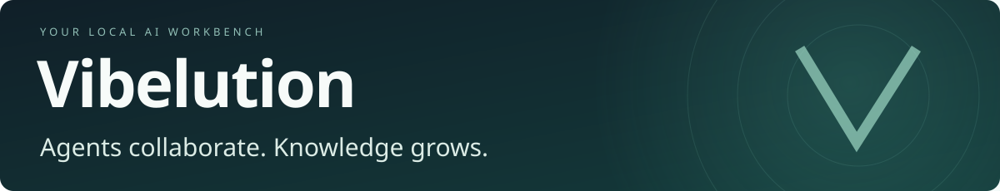
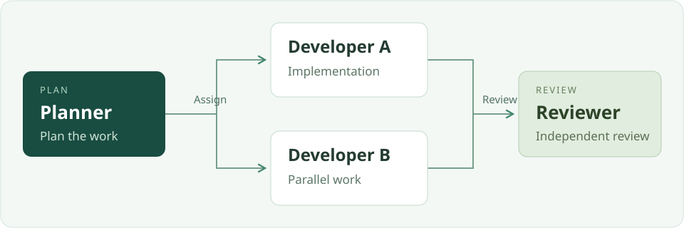

<picture>
  <source media="(max-width: 600px)" srcset="docs/assets/readme/showcase/cover-mobile.en.svg">
  
</picture>

<p align="center">
  <a href="README.md">中文</a> · English<br>
  <a href="#start">Quick start</a> · <a href="#features">Feature tour</a> · <a href="docs/guides/first-conversation.en.md">First conversation</a> · <a href="docs/README.md">Documentation</a><br>
  Local workbench &nbsp; / &nbsp; Local or cloud models &nbsp; / &nbsp; MIT code license
</p>

<a id="teams"></a>
## One team, distinct roles

Assign planning, development, and review to different Agents. See their responsibilities on one canvas, coordinate through group chat and member messages, and retain discussion and handoff records.

<picture>
  <source media="(max-width: 600px)" srcset="docs/assets/readme/showcase/team-flow-mobile.en.svg">
  
</picture>

*Role illustration based on the team screenshot, not a product interface. [See the actual team canvas ↓](#team-interface)*

<a id="features"></a>
## From everyday conversations to ongoing collaboration

| What you want to do | In Vibelution |
| --- | --- |
| [Start a conversation or coding task](#conversation) | Organize sessions by Agent and team; inspect tool activity and workspace artifacts. |
| [Work as a team](#teams) | Define member roles and coordinate through the canvas, group chat, and member sessions. |
| [Get help from a personal assistant](#personal-assistant) | Organize daily tasks and goals, check platform status, and manage Agents and sessions through authorized tools. |
| [Keep material for next time](#knowledge) | Manage private memory and formal knowledge; browse topics and trace sources. |
| [Improve through verification](#evolution) | Follow baselines, candidates, reevaluation, review, and runtime activation. |
| [Conduct financial research](#finance) | Organize research, market data, simulated assets, and reports in a dedicated workspace. |
| [Spend time with a virtual companion](#companion) | Chat in character scenes and configure life and memory for plugin-enabled Agents. |

<a id="start"></a>
## Start your first conversation

Start with the **Windows desktop workbench**. Install Python 3.11+ (3.12 recommended), Node.js 22.12+, and Git, then run in PowerShell:

```powershell
git clone https://github.com/CCDawn/Vibelution.git
cd Vibelution
powershell -ExecutionPolicy Bypass -File scripts/install_windows.ps1
```

1. Open **Vibelution Launcher** from your desktop. Follow the [model configuration guide](docs/ops/config/INDEX.md) to configure a provider, model, and credential reference.
2. Open Chat, create or select an Agent, and start a new session.
3. Send your first message. Once you receive a reply, try files, tools, or team tasks.

[First conversation →](docs/guides/first-conversation.en.md) · [Windows installation and troubleshooting](docs/guides/install-windows.md) · [macOS](docs/guides/install-macos.md) · [Linux](docs/guides/install-linux.md)

macOS and Linux use the browser workbench. Installation currently requires the runtimes above; a portable installer is still planned. The workbench runs locally. Cloud model requests are sent to the selected provider and may incur charges.

<a id="team-interface"></a>
## The actual team canvas

The member list, organization canvas, and member details share one workspace. Select a node to inspect its role, and use group chat or member messages for discussion.

[](docs/assets/readme/showcase/team.png)

*Original user-provided screenshot; click to enlarge. The canvas shows organizational relationships, with historical task records on the right. Product screenshots show the Chinese interface.*

<a id="conversation"></a>
## 01 / Start with one session

Choose different Agents for different tasks, keeping everyday questions, project discussions, and coding work in their own sessions. Team groups and multiple tabs help you return to the work you care about.

[](docs/assets/readme/showcase/conversation.png)

**Organize by task:** browse Agents, teams, and sessions together. **Follow the work:** inspect answers and tool activity, then continue with workspace files, previews, and the terminal.

*The screenshot shows a new session and its navigation and composer, not a completed task.*

[Chat and workspace](web/src/routes/chat/README.md) · [Tool authorization](docs/agents/tool-authorization-entrypoints.md)

<a id="knowledge"></a>
## 02 / Keep knowledge connected to its sources

Agent-private memory, team material, and formal knowledge have separate management surfaces. Browse the knowledge overview by topic, then open individual materials and their sources to carry useful context into your next task.

[](docs/assets/readme/showcase/knowledge.png)

**Find material through topics:** browse groups and search knowledge and sources. **Retain evidence:** formal knowledge supports proposals, review, and source management; private memory keeps its own access boundaries.

*The clusters represent topic groups. The displayed data has not established content relations such as support or contradiction; spatial distance does not imply causality or support.*

[Memory and retrieval](core/web/services/memory_rag_services.md) · [Team knowledge](core/web/services/team_knowledge/README.md)

<a id="evolution"></a>
## 03 / Review the evidence behind each improvement

Self-evolution checks, changes, and verifies work against a goal. Supervised evolution brings the baseline, candidate, and independent reevaluation into one process, with review deciding whether to integrate the result.

[](docs/assets/readme/showcase/evolution.png)

**Inspect the review:** retain Agent conversations, candidate changes, and reevaluation records. **Distinguish stages:** evaluation, approval, integration, and runtime activation are separate; one successful stage does not complete the entire process.

*The score belongs only to the displayed evaluation case. The interface still reports candidate activation without runtime-version evidence; it is not a claim that general capability improved from 30 to 99. Continuous self-evolution requires user approval and stop conditions.*

[Evolution modes](core/web/services/evolution_services.md) · [Evolution configuration](docs/ops/config/06-agent-evolution.md)

<a id="finance"></a>
## 04 / A dedicated financial research workspace

Research stocks and topics with analyst collaboration, market data, simulated accounts, portfolio research, and report materials in one place, reducing the need to move context between tools.

[](docs/assets/readme/showcase/finance.png)

| Work area | Available entry points |
| --- | --- |
| Research and collaboration | Stock research, topic research, analyst collaboration, research tasks |
| Market data and simulated assets | Watchlist quotes, stock screening, simulated accounts, portfolio research, historical backtests, trade review |
| Materials and learning | Reports, research memory, skills, learning |

*The screenshot shows the workspace before research starts. Market data and research require the relevant services, data, and model configuration. Simulated accounts and historical backtests are not live trading; broker trade execution is not included.*

[Financial workspace](web/src/routes/finance/README.md) · [Financial report service setup](docs/ops/config/financial-report-agent.md)

<a id="companion"></a>
## 05 / There is room for everyday life, too

Continue everyday conversations in character scenes. Configure identity, schedules, emotions, and long-term memory for Agents with the virtual-human plugin explicitly enabled.

[](docs/assets/readme/showcase/companion.png)

**Character and scene:** an immersive interface with life status and conversation together. **Conversation continuity:** the plugin provides proactive-contact, unfinished-topic, and memory mechanisms, subject to enablement and configuration.

*The screenshot shows the conversation interface. Proactive scheduling and animated presentation depend on runtime support. Character names and third-party assets belong to their respective rights holders.*

[Virtual-human plugin](core/agent_plugins/virtual_human_life/README.md)

<a id="personal-assistant"></a>
## 06 / A personal assistant for your tasks and goals

Bring daily tasks, near-term goals, and work across the platform into one conversation. Your first visit to the **Personal assistant** page initializes a dedicated Agent and session. Configure a model to start chatting.

| What you can ask for | Available capabilities |
| --- | --- |
| Organize tasks and goals | Discuss your to-do list, break down the next step, and record preferences and goals in the assistant's own private memory. |
| Check platform status | View Agents, sessions, activity, and items awaiting confirmation; filter by status and open the relevant session. |
| Manage on request | Create, update, or archive Agents; create, stop, or delete sessions. Management actions go through the platform's tool approval flow. |
| Keep chatting on the desktop | Use a floating window on Windows. The page and desktop mode share one assistant identity, session, and memory. |

Try asking: **"Check which tasks are running, awaiting confirmation, or in an error state, and suggest what I should do. Observe first; do not make changes."**

The floating window requires the Windows desktop workbench. [Model configuration](docs/ops/config/INDEX.md) · [Tool authorization](docs/agents/tool-authorization-entrypoints.md)

## Configure the workbench your way

| Supporting capability | Purpose |
| --- | --- |
| **Agent configuration** | Configure identity, models, prompts, and tool permissions separately. |
| **Tools, Skills, and MCP** | Inspect tool authorization, browse local skills, and configure managed MCP access. |
| **Git and file review** | Inspect repository status, file differences, and commits to understand task changes. |
| **Models and usage** | Configure model services and inspect usage and local model status. |
| **Logs and runtime diagnostics** | Inspect execution records and investigate problems. |

[Models and usage](docs/ops/config/INDEX.md) · [MCP access](docs/agents/mcp-managed-agent-gateway.md) · [Git configuration](docs/ops/config/08-git-ui-user.md) · [Local model monitoring](docs/ops/local-model-monitor.md)

## Documentation and participation

[Contributing](CONTRIBUTING.md) · [Documentation map](docs/README.md) · [Testing guide](tests/README.md) · [Changelog](CHANGELOG.md) · [Report an issue](https://github.com/CCDawn/Vibelution/issues) · [Security](SECURITY.md)

Related projects: [briefbound-skills](https://github.com/CCDawn/briefbound-skills) · [Codex-Dynamic-Skin](https://github.com/CCDawn/Codex-Dynamic-Skin) · [harmony-codex](https://github.com/CCDawn/harmony-codex) · [pc-touchpad](https://github.com/CCDawn/pc-touchpad)

[MIT code license](LICENSE) · [Third-party components](THIRD_PARTY_COMPONENTS.md)

[Media sources and notes](docs/assets/readme/README.md). Screenshots show feature entry points and their state at capture time; they do not replace functional acceptance. The code license does not grant rights to third-party character assets.
