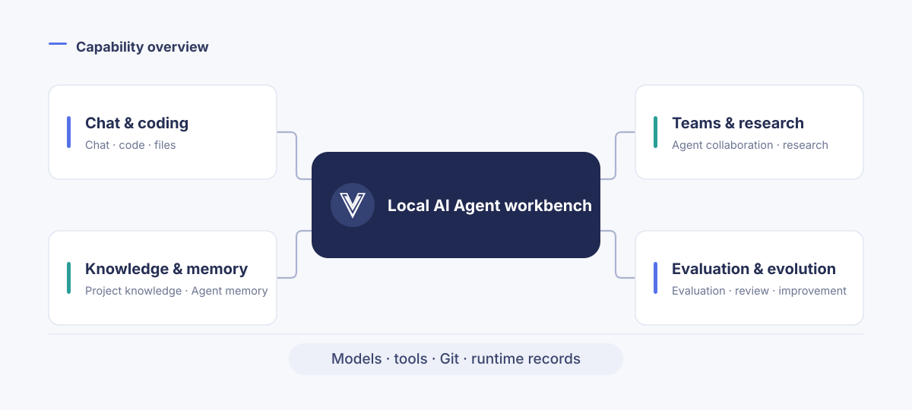
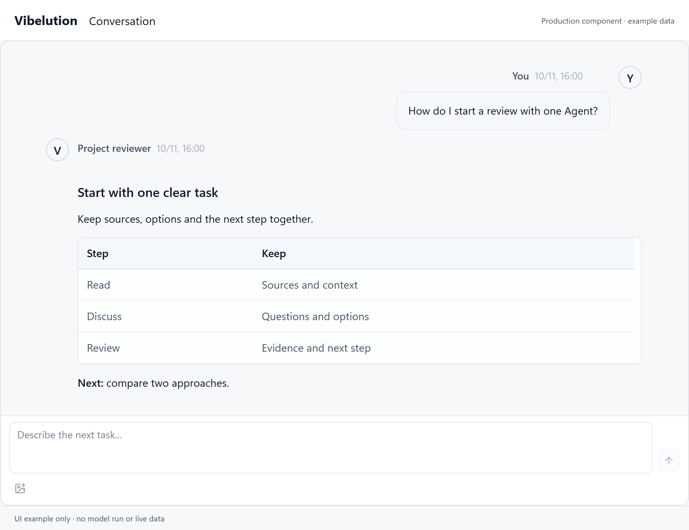
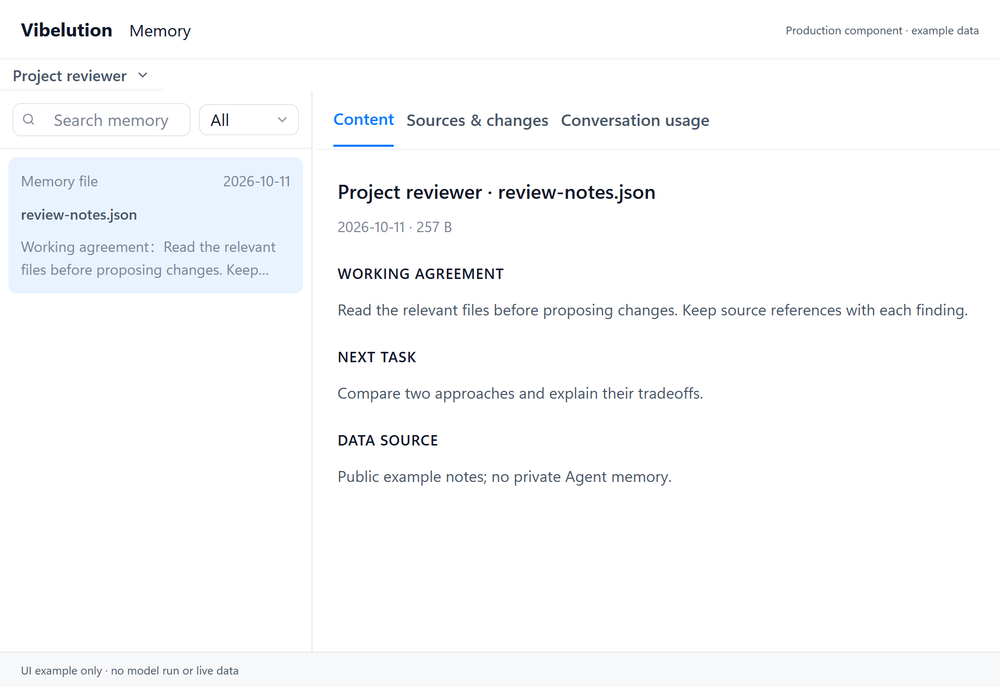
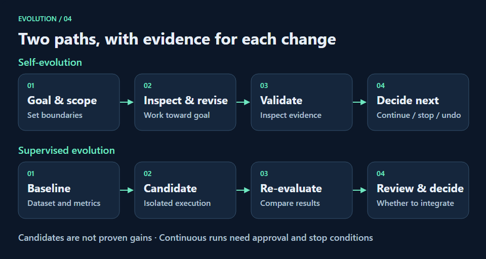

<h1 align="center">Vibelution</h1>

<p align="center"><strong>Your local AI Agent workbench</strong></p>
<p align="center">Start with a conversation. Bring coding, team research, knowledge, and continuous improvement together.</p>

<p align="center">
  <a href="README.md">中文</a> · English<br>
  <a href="#quick-start">Quick start</a> · <a href="docs/guides/first-conversation.en.md">First conversation</a> · <a href="#what-you-can-do">Feature tour</a>
</p>

<p align="center">
  <a href="LICENSE"></a>
  <a href="docs/guides/install-windows.md"></a>
  <a href="https://github.com/CCDawn/Vibelution/issues"></a>
</p>

<picture>
  <source media="(max-width: 600px)" srcset="docs/assets/readme/product-overview.mobile.en.svg">
  
</picture>

*Capability diagram. Conversation and memory images use current production components with public example data; the research video and character lobby are labeled as historical material. [Media sources and reproduction](docs/assets/readme/README.md)*

## What you can do

| Capability | What it helps you do |
| --- | --- |
| **Chat and coding** | Start tasks with one Agent, manage sessions, inspect answers and tool activity, browse workspace files, preview outputs, and use a terminal. |
| **Agents and tools** | Configure identities, models, prompts, and permissions independently; manage Skills and MCP integration. |
| **Teams and research** | Assign roles, use group chat and message handoffs, and connect sources, discussions, human checkpoints, and outputs on a research canvas. |
| **Knowledge and memory** | Read each Agent's private memory, organize project and team material, and retrieve context for later work. |
| **Evaluation and evolution** | Inspect and improve against a goal, or evaluate a candidate against a baseline; review validation and rollback records. |
| **Git and versions** | Inspect repository status and diffs, manage commits, and track project changes in the workbench. |
| **Models and runtime** | Configure models and usage, monitor local models, and inspect logs and runtime diagnostics. |

The workbench runs on your machine. Models can use local or cloud services according to your configuration; cloud requests go to the chosen provider and may incur charges. Tool use, cross-Agent communication, and evolution follow permissions and environment constraints.

## Quick start

Start with the **Windows desktop workbench**. Install **Python 3.11+ (3.12 recommended), Node.js 22.12+, and Git**, then run in PowerShell:

```powershell
git clone https://github.com/CCDawn/Vibelution.git
cd Vibelution
powershell -ExecutionPolicy Bypass -File scripts/install_windows.ps1
```

1. Open **Vibelution Launcher** from your desktop. Follow the [model configuration guide](docs/ops/config/INDEX.md) to set up a provider, model, and credential reference. The default config file is `%USERPROFILE%\Documents\Vibelution\config\config.toml`.
2. Open `Chat`, create or select one Agent, and start a session.
3. Send a text-only question. Once you see your message and the Agent's reply, try files, tools, or team tasks.

**[Follow the first-conversation guide →](docs/guides/first-conversation.en.md)**

[Windows installation and troubleshooting](docs/guides/install-windows.md) · [macOS](docs/guides/install-macos.md) · [Linux](docs/guides/install-linux.md) · [Deploy with an AI Agent](docs/guides/agent-deploy-runbook.md)

On macOS / Linux, follow the platform guide to launch the browser workbench from a terminal. Installation currently requires the runtimes above; a portable package is still planned.

## From one task to ongoing collaboration

### Read, discuss, and code in a conversation

Let one Agent understand the problem, inspect relevant files, propose an approach, and carry out authorized work. Answers, tool activity, and workspace outputs are available in the same workbench.

<picture>
  <source media="(max-width: 600px)" srcset="docs/assets/readme/conversation.mobile.en.png">
  
</picture>

*Production conversation component captured on 2026-10-11 with fixed public example data; no model was called. [First conversation](docs/guides/first-conversation.en.md) · [Tool permissions](docs/agents/tool-authorization-entrypoints.md) · [MCP integration](docs/agents/mcp-managed-agent-gateway.md)*

### Track project changes in the workbench

Open Git from the global navigation, inspect changed files and diffs, then choose the scope of your commit. Worktrees, branch status, and recent commits share one page so you can check what an Agent changed.

[Git configuration](docs/ops/config/08-git-ui-user.md)

### Keep sources and experience for the next task

Agents have separate private memory, alongside dedicated project-knowledge and team-material surfaces. Read file content, retrieve material, and check its sources to spend less time repeating context.

<picture>
  <source media="(max-width: 600px)" srcset="docs/assets/readme/memory.mobile.en.png">
  
</picture>

*Production memory component captured on 2026-10-11 with public example notes. Stored does not mean used in a conversation; a current file snapshot is not a full revision history. [Memory and retrieval](core/web/services/memory_rag_services.md) · [Team knowledge](core/web/services/team_knowledge/README.md)*

### Move research and review forward as a team

Assign members to research, analysis, coding, and review. Exchange material through group chat, member messages, and team broadcasts. The research canvas shows dependencies, human checkpoints, and intermediate outputs; follow delivery and execution separately during handoffs.

<details>
<summary><strong>Explore a research case: canvas, team discussion, and knowledge graph</strong></summary>

[](docs/assets/readme/challenge-cup-demo.mp4)

[▶ Full demo · 2m 37s · 1080p](docs/assets/readme/challenge-cup-demo.mp4) · [Download MP4](docs/assets/readme/challenge-cup-demo.mp4?raw=true)

Historical research-data replay recorded on 2026-09-08, with Chinese narration and subtitles. It illustrates the workflow. Experiment execution depends on adapters, data, and environment; scientific conclusions require original sources and experimental results.

[Research canvas original](docs/assets/readme/research-workflow.png) · [Knowledge graph original](docs/assets/readme/challenge-cup-graph.png)

</details>

[Research workflow](core/web/services/team_workflow/README.md) · [Communication model](docs/adr/0002-agent-collaboration-session-addressing.md)

### Let validation guide improvement

Self-evolution inspects, revises, and validates against a goal. Supervised evolution evaluates a candidate against a baseline before an integration decision. Inspect changes, evaluations, and rollback records to preserve the basis for each decision.

<details>
<summary><strong>Explore the two evolution workflows</strong></summary>



Conceptual diagram. A proposal or candidate does not establish a gain; continuous self-evolution requires user approval and stopping conditions.

</details>

[Evolution modes](core/web/services/evolution_services.md) · [Evolution configuration](docs/ops/config/06-agent-evolution.md)

## Specialized extensions

- **Financial research:** dedicated modules for market and report research, preferences, backtesting, and more. [Financial research](core/web/services/financial_research/README.md) · [Report-service integration](docs/ops/config/financial-report-agent.md). External services require separate deployment and validation; backtests are for historical research.
- **Virtual characters and desktop companions:** configure identities, schedules, moods, and long-term memory for Agents with the plugin explicitly enabled. Life and conversation continuity are still being refined. [Virtual-life plugin](core/agent_plugins/virtual_human_life/README.md) · [Historical character-lobby capture](docs/assets/readme/companions.png) · [Desktop companion idle animation](docs/assets/readme/desktop-pet.gif)

## Documentation and participation

[Model and usage configuration](docs/ops/config/INDEX.md) · [Git configuration](docs/ops/config/08-git-ui-user.md) · [Local-model monitoring](docs/ops/local-model-monitor.md) · [Changelog](CHANGELOG.md)

**Developer references:** [Contributing](CONTRIBUTING.md) · [Source and documentation map](docs/README.md) · [Tool implementation index](tools/README.md) · [Testing](tests/README.md) · [Security](SECURITY.md)

Report problems or suggest improvements through [GitHub Issues](https://github.com/CCDawn/Vibelution/issues). Include your platform, reproduction steps, and expected behavior to help locate the issue.

**Related projects:** [briefbound-skills](https://github.com/CCDawn/briefbound-skills) · [Codex-Dynamic-Skin](https://github.com/CCDawn/Codex-Dynamic-Skin) · [harmony-codex](https://github.com/CCDawn/harmony-codex) · [pc-touchpad](https://github.com/CCDawn/pc-touchpad)

[MIT code license](LICENSE) · [Third-party components](THIRD_PARTY_COMPONENTS.md) · [Media sources](docs/assets/readme/README.md). Character names and third-party assets belong to their respective rights holders; the code license does not grant rights to those assets.
