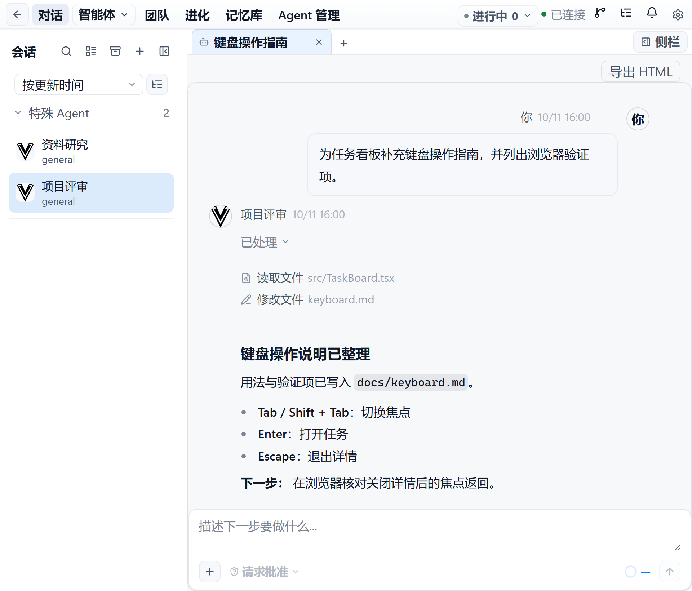
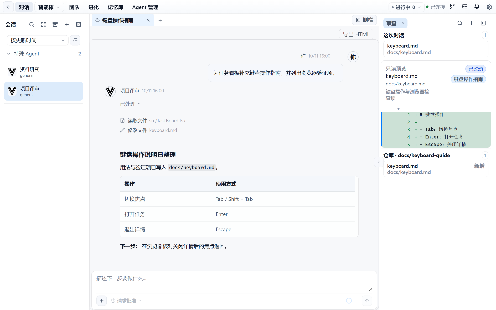
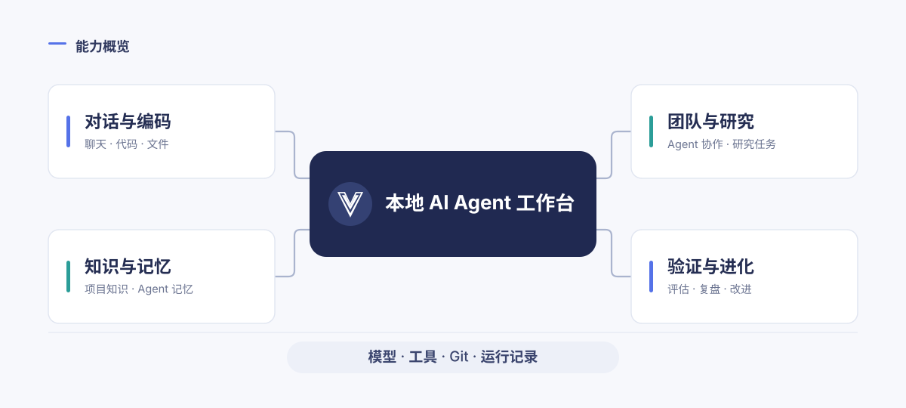
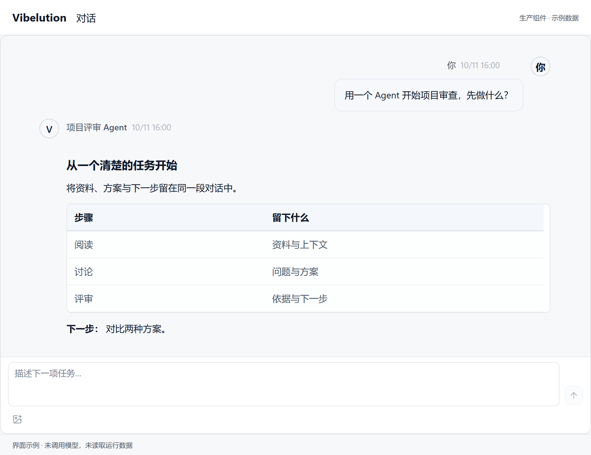
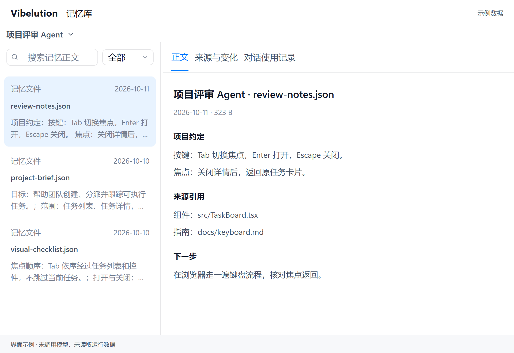
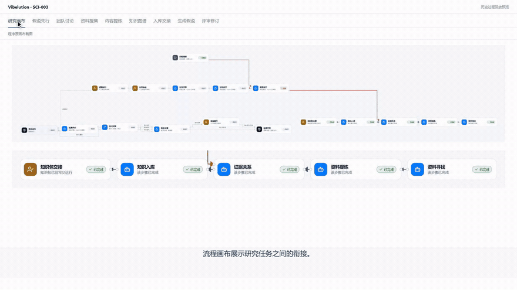
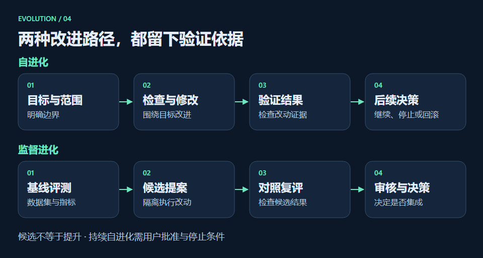

<h1 align="center">Vibelution</h1>

<p align="center"><strong>你的本地 AI Agent 工作台</strong></p>
<p align="center">从一次对话开始，把编码、团队研究、知识积累与持续改进放在一起。</p>

<p align="center">
  中文 · <a href="README.en.md">English</a><br>
  <a href="#快速开始">快速开始</a> · <a href="docs/guides/first-conversation.md">第一次对话</a> · <a href="#工作台里能做什么">功能导览</a>
</p>

<p align="center">
  <a href="LICENSE"></a>
  <a href="docs/guides/install-windows.md"></a>
  <a href="https://github.com/CCDawn/Vibelution/issues"></a>
</p>

<picture>
  <source media="(max-width: 600px)" srcset="docs/assets/readme/workbench.mobile.zh.png">
  
</picture>

*工作台路由的隔离展示，使用固定公开任务数据，未调用模型。[素材来源与再生成](docs/assets/readme/README.md)*

<details>
<summary><strong>查看完整三栏工作台与文件审查</strong></summary>

[](docs/assets/readme/workbench-overview.zh.png)

同一生产路由的宽屏取景；点击图片可查看原图。

</details>

从一次会话开始，Agent 可以阅读项目、执行获准的工具操作，并把回答、过程和文件改动留在同一工作区里。你能在任务推进时核对它做了什么，再按需要延伸到团队研究与知识复用。

## 快速开始

推荐先体验 **Windows 桌面工作台**。准备 **Python 3.11+（推荐 3.12）、Node.js 22.12+ 和 Git**，在 PowerShell 中执行：

```powershell
git clone https://github.com/CCDawn/Vibelution.git
cd Vibelution
powershell -ExecutionPolicy Bypass -File scripts/install_windows.ps1
```

1. 打开桌面的 **Vibelution Launcher**，按[模型配置指南](docs/ops/config/INDEX.md)填写服务商、模型和密钥引用。配置文件默认位于 `%USERPROFILE%\Documents\Vibelution\config\config.toml`。
2. 进入「对话」，创建或选择一个 Agent，然后新建会话。
3. 发送一条普通文字问题；看到自己的消息和 Agent 回复后，再尝试文件、工具或团队任务。

**[跟着「第一次对话」完成上手 →](docs/guides/first-conversation.md)**

[Windows 安装与排错](docs/guides/install-windows.md) · [macOS](docs/guides/install-macos.md) · [Linux](docs/guides/install-linux.md) · [让 AI 帮你部署](docs/guides/agent-deploy-runbook.md)

macOS / Linux 按对应指南从终端启动浏览器工作台。当前安装需要上述运行环境，便携安装包仍在规划中。

## 工作台里能做什么

| 能力 | 你可以做什么 |
| --- | --- |
| **对话与编码** | 与单个 Agent 开始任务，管理会话，查看回答与工具过程；浏览工作区文件、预览产物并使用终端。 |
| **Agent 与工具** | 分别配置身份、模型、提示词与工具权限，管理 Skills 和 MCP 接入。 |
| **团队与研究** | 组织成员分工、群聊与消息交接，用研究画布串起资料、讨论、人工确认和阶段产物。 |
| **知识与记忆** | 阅读各 Agent 的私有记忆，整理项目知识与团队资料，结合检索继续工作。 |
| **验证与进化** | 围绕目标检查和改进，或对照基线评估候选，查看验证、审核与回滚记录。 |
| **Git 与版本** | 在工作台检查仓库状态与差异，管理提交，追踪项目改动。 |
| **模型与运行** | 配置模型与用量，监控本地模型，查看日志与运行诊断。 |

工作台在本机运行。模型可以按配置接入本地或云端服务；云端请求会发给所选服务商并可能产生费用。工具调用、跨 Agent 通信和进化执行受授权与环境约束。

<details>
<summary><strong>展开查看整体能力关系图</strong></summary>

<picture>
  <source media="(max-width: 600px)" srcset="docs/assets/readme/product-overview.mobile.zh.svg">
  
</picture>

</details>

## 从一个任务到持续协作

### 在对话里阅读、讨论与编码

让一个 Agent 先理解问题，再阅读相关文件、提出方案和完成授权的操作。回答、工具过程与工作区产物可以在同一工作台中查看。

<details>
<summary><strong>查看会话界面示例</strong></summary>

<picture>
  <source media="(max-width: 600px)" srcset="docs/assets/readme/conversation.mobile.zh.png">
  
</picture>

*2026-10-11 生产会话组件的隔离示例，使用固定公开数据，未调用模型。*

</details>

[第一次对话](docs/guides/first-conversation.md) · [工具授权](docs/agents/tool-authorization-entrypoints.md) · [MCP 接入](docs/agents/mcp-managed-agent-gateway.md)

### 在工作台中追踪项目改动

从全局导航进入 Git，检查文件变化与 diff，再决定本次提交的范围。工作区、分支状态和最近提交放在同一个页面中，方便核对 Agent 改了什么。

[Git 配置](docs/ops/config/08-git-ui-user.md)

### 把资料和经验留给下一次工作

各 Agent 的私有记忆独立管理；项目知识与团队资料有各自的入口。可以阅读文件正文、检索材料并核对来源，减少每次重新交代背景的成本。

<picture>
  <source media="(max-width: 600px)" srcset="docs/assets/readme/memory.mobile.zh.png">
  
</picture>

*2026-10-11 生产记忆组件的隔离示例，展示公开笔记。保存过不等于已在对话中使用过；当前文件快照也不代表完整修改历史。[记忆与检索](core/web/services/memory_rag_services.md) · [团队知识库](core/web/services/team_knowledge/README.md)*

### 让团队推进研究与评审

为调研、分析、编码与评审安排不同成员，通过群聊、成员消息和团队广播交换材料。研究画布展示任务依赖、人工确认与阶段产物；交接时可分别跟进投递和执行状态。

<details>
<summary><strong>查看科研案例：画布、团队讨论与知识图谱</strong></summary>

[](docs/assets/readme/challenge-cup-demo.mp4)

[▶ 完整演示 · 2 分 37 秒 · 1080p](docs/assets/readme/challenge-cup-demo.mp4) · [下载 MP4](docs/assets/readme/challenge-cup-demo.mp4?raw=true)

2026-09-08 录制的科研历史数据回放，含中文配音与字幕，展示流程。实验执行取决于适配器、数据与环境；学术结论仍需核对原始来源和实验结果。

[研究画布原图](docs/assets/readme/research-workflow.png) · [知识图谱原图](docs/assets/readme/challenge-cup-graph.png)

</details>

[研究工作流](core/web/services/team_workflow/README.md) · [通信机制](docs/adr/0002-agent-collaboration-session-addressing.md)

### 用验证决定下一次改进

自进化围绕目标检查、修改与验证；监督进化对照基线复评候选，再由审核决定是否集成。查看改动、评测与回滚记录，保留每次取舍的依据。

<details>
<summary><strong>查看两种进化方式的流程</strong></summary>



机制示意。提案与候选不代表已经提升；持续自进化需用户批准并设置停止条件。

</details>

[进化模式](core/web/services/evolution_services.md) · [进化配置](docs/ops/config/06-agent-evolution.md)

## 专项扩展

- **金融研究：** 行情与财报研究、偏好、回测等独立领域模块。[金融研究](core/web/services/financial_research/README.md) · [财报服务接入](docs/ops/config/financial-report-agent.md)。外部服务需单独部署与验证；回测结果用于历史研究。
- **虚拟人与桌面伙伴：** 为显式启用插件的 Agent 配置人物身份、日程、情绪与长期记忆。生活与对话连续性仍在打磨。[虚拟人插件](core/agent_plugins/virtual_human_life/README.md) · [人物大厅历史截图](docs/assets/readme/companions.png) · [桌宠待机动效](docs/assets/readme/desktop-pet.gif)

## 文档与参与

[模型与用量配置](docs/ops/config/INDEX.md) · [Git 配置](docs/ops/config/08-git-ui-user.md) · [本地模型监控](docs/ops/local-model-monitor.md) · [更新记录](CHANGELOG.md)

**开发者参考：** [贡献指南](CONTRIBUTING.md) · [源码与文档地图](docs/README.md) · [工具实现索引](tools/README.md) · [测试指南](tests/README.md) · [安全问题](SECURITY.md)

欢迎通过 [GitHub Issues](https://github.com/CCDawn/Vibelution/issues)反馈问题或提出建议。描述你的平台、复现步骤和预期行为，会让问题更容易定位。

**相关项目：** [briefbound-skills](https://github.com/CCDawn/briefbound-skills) · [Codex-Dynamic-Skin](https://github.com/CCDawn/Codex-Dynamic-Skin) · [harmony-codex](https://github.com/CCDawn/harmony-codex) · [pc-touchpad](https://github.com/CCDawn/pc-touchpad)

[MIT 代码许可证](LICENSE) · [第三方组件](THIRD_PARTY_COMPONENTS.md) · [展示素材来源](docs/assets/readme/README.md)。角色名称与第三方素材的权利归各自权利人所有，代码许可证不授予这些素材的权利。
