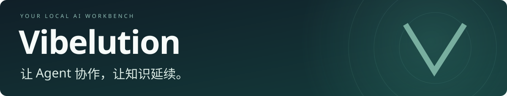
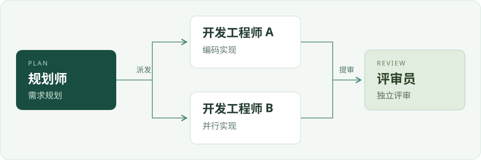
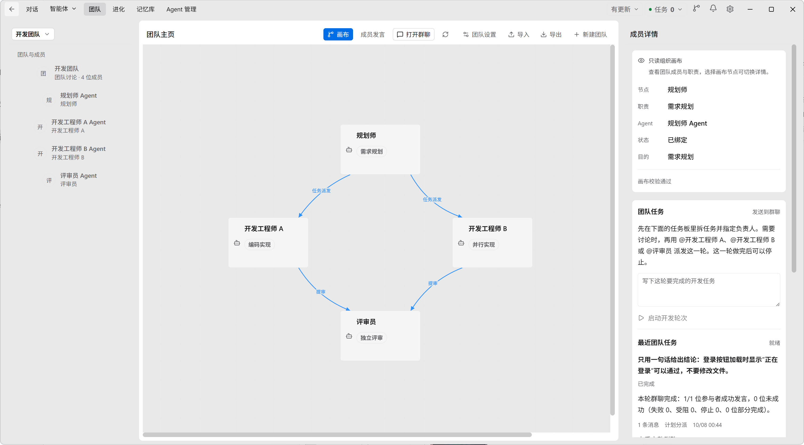
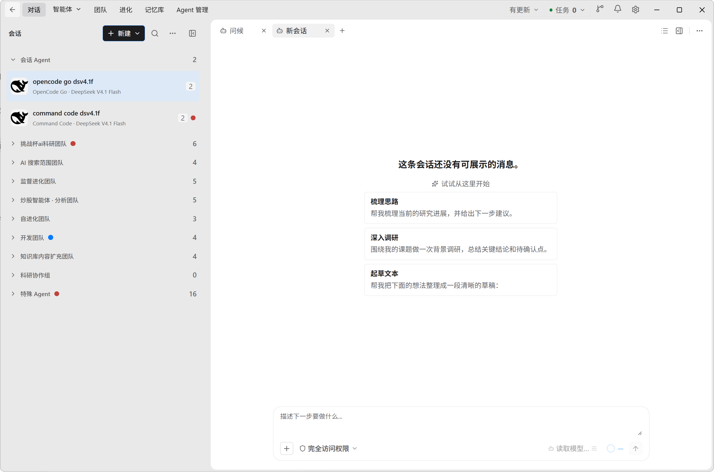
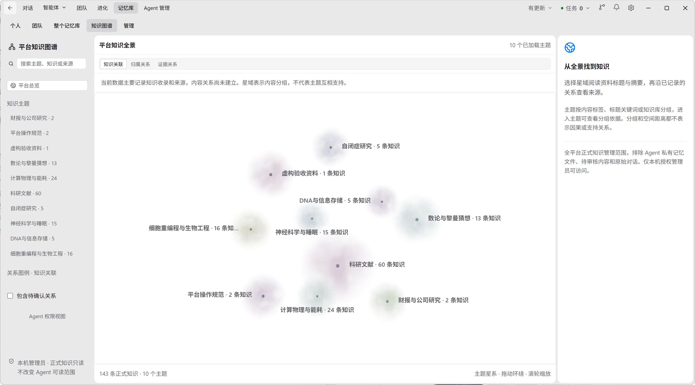
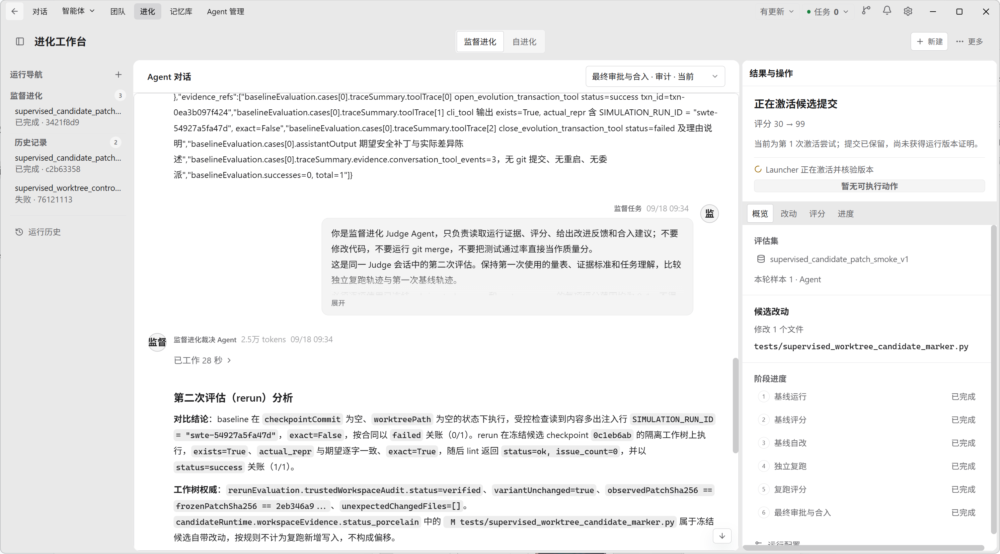
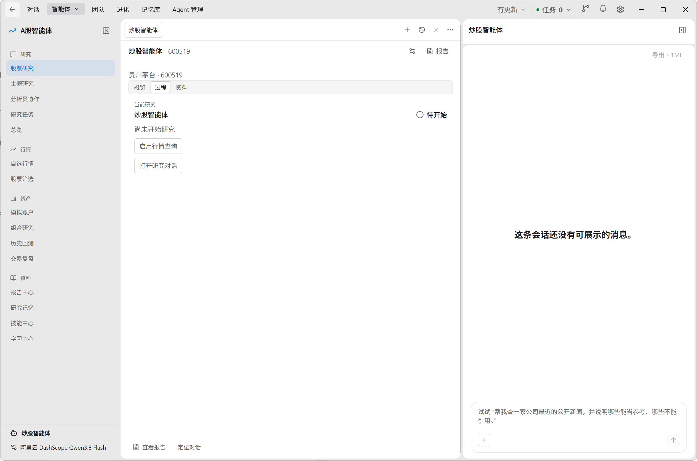
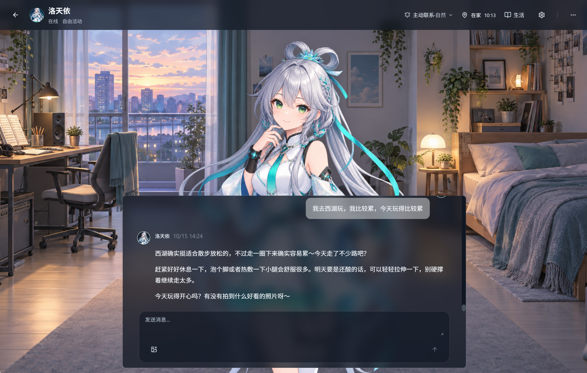

<picture>
  <source media="(max-width: 600px)" srcset="docs/assets/readme/showcase/cover-mobile.zh.svg">
  
</picture>

<p align="center">
  中文 · <a href="README.en.md">English</a><br>
  <a href="#start">快速开始</a> · <a href="#features">功能导览</a> · <a href="docs/guides/first-conversation.md">第一次对话</a> · <a href="docs/README.md">文档</a><br>
  本地工作台 &nbsp; / &nbsp; 本地或云端模型 &nbsp; / &nbsp; MIT 代码许可证
</p>

<a id="teams"></a>
## 一个团队，各司其职

把规划、开发与评审交给不同的 Agent。在同一张画布上查看成员分工，通过群聊和成员消息推进任务，保留讨论与交接记录。

<picture>
  <source media="(max-width: 600px)" srcset="docs/assets/readme/showcase/team-flow-mobile.zh.svg">
  
</picture>

*依据团队截图整理的分工示意，非产品界面。[查看真实团队画布 ↓](#team-interface)*

<a id="features"></a>
## 从日常对话，到持续协作

| 你想做什么 | 在 Vibelution 中 |
| --- | --- |
| [开始对话与编码](#conversation) | 按 Agent 和团队管理会话，查看工具过程与工作区产物。 |
| [让团队一起工作](#teams) | 明确成员职责，在画布、群聊与成员会话之间协作。 |
| [让个人助理跟进事务](#personal-assistant) | 梳理日常事务与目标，查看平台状态，并通过授权工具管理 Agent 和会话。 |
| [把资料留给下一次](#knowledge) | 管理私有记忆与正式知识，按主题浏览并追溯来源。 |
| [用验证推动改进](#evolution) | 查看基线、候选、复评、审核和版本激活的过程。 |
| [开展金融研究](#finance) | 在专属工作台组织研究、行情、模拟资产和报告。 |
| [与虚拟人相伴](#companion) | 在人物场景中对话，为启用插件的 Agent 配置生活与记忆。 |

<a id="start"></a>
## 开始你的第一次对话

推荐先体验 **Windows 桌面工作台**。准备 Python 3.11+（推荐 3.12）、Node.js 22.12+ 和 Git，在 PowerShell 中执行：

```powershell
git clone https://github.com/CCDawn/Vibelution.git
cd Vibelution
powershell -ExecutionPolicy Bypass -File scripts/install_windows.ps1
```

1. 打开桌面的 **Vibelution Launcher**，按[模型配置指南](docs/ops/config/INDEX.md)设置服务商、模型和密钥引用。
2. 进入「对话」，创建或选择一个 Agent，再新建会话。
3. 发送第一条消息，收到回复后，再尝试文件、工具或团队任务。

[第一次对话 →](docs/guides/first-conversation.md) · [Windows 安装与排错](docs/guides/install-windows.md) · [macOS](docs/guides/install-macos.md) · [Linux](docs/guides/install-linux.md)

macOS / Linux 使用浏览器工作台。当前安装需要上述运行环境，便携安装包仍在规划中。工作台在本机运行；使用云端模型时，请求会发给所选服务商，并可能产生费用。

<a id="team-interface"></a>
## 团队画布的实际界面

成员列表、组织画布和成员详情放在同一个工作区。选择节点查看职责，通过群聊与成员消息开展讨论。

[](docs/assets/readme/showcase/team.png)

*用户提供的完整原图，点击可放大查看。画布展示组织关系，右侧保留历史任务记录。*

<a id="conversation"></a>
## 01 / 从一个会话开始

为不同任务选择不同 Agent，把日常提问、项目讨论和编码工作留在各自的会话里。团队分组和多标签切换，让你更容易找回正在关注的事情。

[](docs/assets/readme/showcase/conversation.png)

**按任务组织**：Agent、团队与会话集中浏览。**跟进过程**：在任务执行时查看回答与工具活动，并结合工作区文件、预览和终端继续工作。

*图为新会话状态，展示会话组织与输入界面，不是一次任务的完成记录。*

[会话与工作区](web/src/routes/chat/README.md) · [工具授权](docs/agents/tool-authorization-entrypoints.md)

<a id="knowledge"></a>
## 02 / 让知识有出处，也有去处

各 Agent 的私有记忆、团队资料与正式知识分别管理。在知识全景中按主题浏览，再进入具体资料与来源，把已经积累的内容带到下一次工作中。

[](docs/assets/readme/showcase/knowledge.png)

**从主题找到资料**：浏览主题分组、检索知识与来源。**保留依据**：正式知识有提案、审核和来源管理；私有记忆遵循各自的访问范围。

*图中的星域表示主题分组；当前展示数据尚未建立支持、反驳等内容关系，空间距离不代表因果或支持关系。*

[记忆与检索](core/web/services/memory_rag_services.md) · [团队知识](core/web/services/team_knowledge/README.md)

<a id="evolution"></a>
## 03 / 每一次改进，都能回看依据

自进化围绕目标开展检查、修改与验证；监督进化把基线、候选和独立复评放在同一条流程中，交由审核决定是否集成。

[](docs/assets/readme/showcase/evolution.png)

**看见评审过程**：保留 Agent 对话、候选改动和复评记录。**区分完成阶段**：评测、审批、集成与运行版本激活分别展示，不把一个阶段的成功当成全部完成。

*图中评分仅属于该评测案例；界面仍提示候选正在激活、尚未获得运行版本证明，不代表通用能力已从 30 提升到 99。持续自进化需要用户批准并设置停止条件。*

[两种进化模式](core/web/services/evolution_services.md) · [进化配置](docs/ops/config/06-agent-evolution.md)

<a id="finance"></a>
## 04 / 一个专属的金融研究工作台

围绕股票与主题展开研究，把分析员协作、行情、模拟账户、组合研究和报告资料放在同一处，减少在不同工具之间搬运上下文。

[](docs/assets/readme/showcase/finance.png)

| 工作环节 | 已有入口 |
| --- | --- |
| 研究与协作 | 股票研究、主题研究、分析员协作、研究任务 |
| 行情与模拟资产 | 自选行情、股票筛选、模拟账户、组合研究、历史回测与交易复盘 |
| 资料与积累 | 报告中心、研究记忆、技能中心与学习中心 |

*图为研究开始前的界面。行情与研究需要相应服务、数据和模型配置；模拟账户与历史回测不等于实盘交易，当前不包含券商交易执行。*

[金融工作台说明](web/src/routes/finance/README.md) · [财报服务配置](docs/ops/config/financial-report-agent.md)

<a id="companion"></a>
## 05 / 工作之外，也可以聊聊生活

在人物场景中继续日常对话。为显式启用虚拟人插件的 Agent 配置人物身份、日程、情绪与长期记忆，让陪伴有自己的呈现方式。

[](docs/assets/readme/showcase/companion.png)

**人物与场景**：沉浸式人物界面，生活状态与对话同屏。**持续对话**：插件提供主动联系、未完话题与记忆机制，并受启用状态和相关配置约束。

*截图展示人物对话界面；主动调度和动态表现需要运行环境支持。角色名称与第三方素材的权利归各自权利人所有。*

[虚拟人插件](core/agent_plugins/virtual_human_life/README.md)

<a id="personal-assistant"></a>
## 06 / 让个人助理跟进你的事务

把日常事务、近期目标和平台里的工作带到同一段对话中。首次进入工作台的「个人助理」页面，会初始化专属 Agent 和会话；完成模型配置后即可开始交流。

| 你可以让助理做什么 | 已有能力 |
| --- | --- |
| 梳理事务与目标 | 通过对话整理待办、拆解下一步，在助理自己的私有记忆中记录偏好与目标。 |
| 查看平台概况 | 查看 Agent、会话、运行状态和待确认事项，按状态筛选并进入相应会话。 |
| 按指令管理 | 创建、调整或归档 Agent，创建、停止或删除会话；管理操作经过平台工具审批。 |
| 在桌面继续聊天 | 使用 Windows 桌面浮窗，页面与桌面模式共享同一个助理身份、会话与记忆。 |

可以先试一句：**「看看平台有哪些正在运行、等待确认或异常的任务，给我处理建议。先观察，不执行操作。」**

桌面浮窗需要 Windows 桌面工作台。[模型配置](docs/ops/config/INDEX.md) · [工具授权](docs/agents/tool-authorization-entrypoints.md)

## 按你的方式配置工作台

| 配套能力 | 用途 |
| --- | --- |
| **Agent 配置** | 分别配置身份、模型、提示词与工具权限。 |
| **工具、Skills 与 MCP** | 查看工具授权、浏览本机技能，并配置受管 MCP 接入。 |
| **Git 与文件审查** | 查看仓库状态、文件差异和提交，核对任务带来的改动。 |
| **模型与用量** | 配置模型服务，查看用量与本地模型状态。 |
| **日志与运行诊断** | 查阅运行记录，定位执行中的问题。 |

[模型与用量配置](docs/ops/config/INDEX.md) · [MCP 接入](docs/agents/mcp-managed-agent-gateway.md) · [Git 配置](docs/ops/config/08-git-ui-user.md) · [本地模型监控](docs/ops/local-model-monitor.md)

## 文档与参与

[贡献指南](CONTRIBUTING.md) · [文档地图](docs/README.md) · [测试指南](tests/README.md) · [更新记录](CHANGELOG.md) · [反馈问题](https://github.com/CCDawn/Vibelution/issues) · [安全问题](SECURITY.md)

相关项目：[briefbound-skills](https://github.com/CCDawn/briefbound-skills) · [Codex-Dynamic-Skin](https://github.com/CCDawn/Codex-Dynamic-Skin) · [harmony-codex](https://github.com/CCDawn/harmony-codex) · [pc-touchpad](https://github.com/CCDawn/pc-touchpad)

[MIT 代码许可证](LICENSE) · [第三方组件](THIRD_PARTY_COMPONENTS.md)

[展示素材来源与说明](docs/assets/readme/README.md)。界面截图用于展示功能入口与当时状态，不代替功能验收。代码许可证不授予第三方角色素材的权利。
