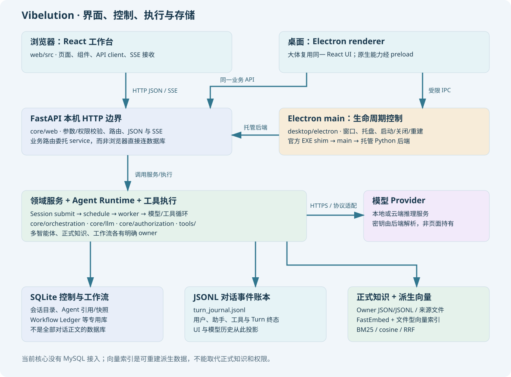

# Vibelution 内部技术架构与源码学习教程

从一次聊天出发，学习前端、Python 后端、Electron 桌面、Agent 执行、持久化和扩展能力如何协作。面向想读懂实现、排查问题或开始贡献的读者。

本教程是**教学参考**，不是新增开发规范。修改项目先阅读根 [AGENTS.md](../../../AGENTS.md)、[贡献指南](../../../CONTRIBUTING.md)及[规范索引](../../standards/README.md)。架构决策见 [ADR](../../adr/README.md)，模块 owner 与接口细节以现行源码和模块 README 为准。

- 核对日期：2026-10-23。
- 源码基准：[CCDawn/Vibelution `4e7e1ef7cf08`](https://github.com/CCDawn/Vibelution/tree/4e7e1ef7cf08760b631c20d08e4f7004c049065d)。
- 路径相对于仓库根；源码链接可在 GitHub 与正常 checkout 中定位。符号链接的行号按上述快照生成，后续移动时应按函数名搜索。
- 内容解释已实现链路，不表示所有可选功能、外部服务、模型权重和自动化授权已经启用。
- 目录表是全量导航，正文是关键机制精读；未逐行审计所有文件，也没有为写教程执行付费推理或数据迁移。

## 按顺序阅读

| 部分 | 章节 | 学习目标 |
| --- | --- | --- |
| [全栈地图与一次聊天](01-foundation.md) | 1—6 | 分清前后端，跟踪发送、模型和工具调用 |
| [存储、历史与 RAG](02-data-and-rag.md) | 7—10 | 区别 SQLite、JSONL、正式知识和派生向量 |
| [多智能体、MCP、Skill 与桌面](03-agents-and-desktop.md) | 11—14 | 解释协作投递、MCP 网关、Skill 和桌面生命周期 |
| [业务模块、例子与学习路线](04-modules-and-learning.md) | 15—24 | 了解其余领域，并按端到端例子和练习学习 |
| [配置、调度、授权、压缩与模型恢复](05-runtime-deep-dive.md) | 25—30 | 追踪配置身份、队列、取消、授权、沙箱和上下文 |
| [附件、回退、后台任务与持久化工作流](06-durable-systems.md) | 31—36 | 理解附件、分支、迟到结果、Outbox、进化和插件 |
| [诊断、前端一致性、CLI 与生命周期](07-engineering-and-reading.md) | 37—41 | 掌握日志、用量、异步 UI、CLI/CUA 和关闭恢复 |

初学者先读第 1—6 章，再读第 7—14 章；已有基础可从第 25 章直接进入核心机制。每部分末尾有前后导航；第 19 章提供七天学习路线，第 41 章提供源码精读练习。

## 按问题查找

| 问题 | 从哪里开始 |
| --- | --- |
| 哪些是前端/后端，交互代码在哪？ | 第 1—5 章；`web/src/api/` → `core/web/routes/` → `core/web/services/` |
| 每个文件夹做什么？ | [目录职责地图](directory-map.md)，再查第 2、16 章及模块 README |
| 后端怎样连接 MySQL、向量数据库？ | 第 7、9、10 章：当前核心使用 SQLite 和文件；向量是 FastEmbed 生成的可重建文件索引 |
| 历史记录怎样保存、重放、分支与回退？ | 第 8、29、32—34 章 |
| Agent 间怎样交互，RAG/MCP/Skill 有何区别？ | 第 9—13、27、36 章 |
| EXE 与网页版有何区别，关闭为何会等待？ | 第 14、40 章 |
| 排队、模型卡住、工具超时怎样区分？ | 第 26—30、33、37 章 |
| 进化、研究、金融、个人助理和虚拟人在哪里？ | 第 15、16、35、36 章 |

## 维护这份教程

实现或默认值变化时，更新对应章节、源码链接和基准版本；不要只替换日期。优先复用现有模块文档，避免复制全局规则。新增下游功能应在其实际实现仓库中说明，不把它写成上游默认能力。

本目录只包含教程和示意图，不包含用户配置、聊天记录、凭据、安装目录或生成过程中的临时证据。原有[交互式架构地图](../index.html)可配合阅读。
