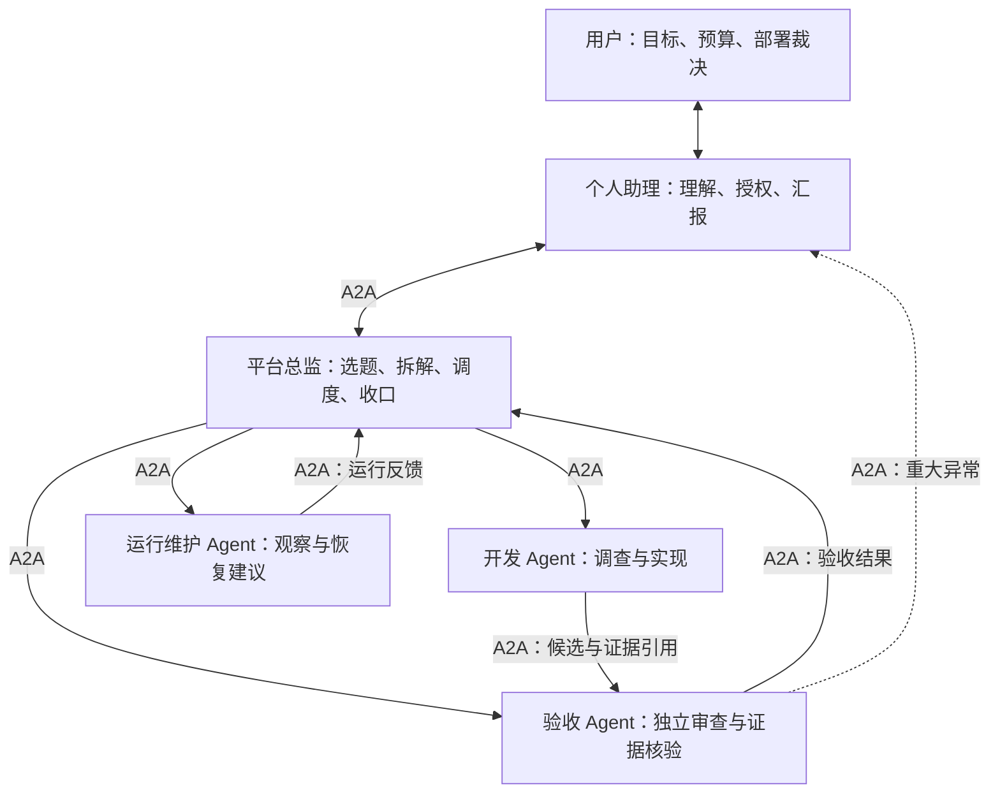

# 平台多 Agent A2A 自迭代 Harness：首版方案

- Status: 用户已确认产品方向与自主边界；本文为待实施方案，不表示功能已上线。
- Updated: 2026-10-18（Asia/Shanghai）。
- 本轮交付：角色、通信、授权、状态、恢复与实施验收约定；仅文档，不创建 Agent、不启动自主任务、不改 operator 配置。
- 关闭条件：下文 T1–T5 完成，真实 Agent 闭环与失败恢复验收有证据；届时更新状态并按 [ADR 0005](../adr/0005-docs-authority-and-archive-policy.md) 归档。
- 权威边界：用户当前授权、根 [AGENTS.md](../../AGENTS.md)、现行标准和 owning service 继续生效。本文不提前放开现有机器限制。

## 1. 已确认的结果

用户通过个人助理表达目标，个人助理向平台总监交办；总监组织开发、独立验收与运行维护，让平台在约定目标内持续发现和处理问题。Agent 之间统一采用标准 A2A；无需逐步骤询问用户。首版自动完成授权范围内的开发、验证和本地合入，部署由用户决定，远端 push / PR / 发布仍需明确授权。

第一条验收链路：个人助理交办一个真实问题 → 总监形成任务约定 → 开发提交候选 → 独立验收 → 受控本地合入 → 个人助理汇报、等待部署决定 → 用户部署后观察实际效果。

首版只接入本项目预先登记的 Agent。外部任意 Agent 联邦、公开互联网发现、多项目调度、自动部署和模型权重训练不在本轮范围；后续可通过同一协议边界扩展。

## 2. 职责与通信拓扑

| 角色 | 对什么负责 | 权限约束 |
| --- | --- | --- |
| 用户 | 长期目标、资源边界、产品重大分歧、部署决定 | 随时查看证据、暂停或撤回授权 |
| 个人助理 | 维护用户意图与授权引用，集中汇报需要裁决的问题 | 不通过消息自封为用户；不代签部署与提权 |
| 平台总监 | 问题池、优先级、任务依赖、资源分配与结果收口 | 不能降低验收要求、自审自己的实现、扩大授权 |
| 开发 Agent | 在声明范围内交付可审查候选 | 隔离 worktree；没有最终验收或部署权 |
| 验收 Agent | 检查固定候选及对应证据，提出通过或返工结论 | 必须独立于该候选开发身份；不能修改被审候选 |
| 运行维护 Agent | 故障观察、归因、运行核验与恢复建议 | 本地合入与运行加载分开；重启和部署遵循现行授权 |

角色不等于持续占用一个 LLM。优先复用已有 Agent / Team 角色配置，执行会话按任务创建或复用。业务协作走 A2A；Git、测试、权限校验和 Launcher 仍由平台现有受控执行入口完成。

总监不转发所有技术消息。开发与验收可以在同一任务范围内直接交流，范围和优先级冲突归总监；重大风险可直接上报个人助理。身份与通信边由组织关系和平台授权校验，Agent 名称、persona 和 Agent Card 自述不能授予权限。

## 3. 现状与复用边界

本节是规划时的静态源码核对，不能代替正式运行实例验收。

| 现有 owner | 已有能力 | 首版需要补齐的部分 |
| --- | --- | --- |
| [Agent 协议模型](../../core/agent_protocol/models.py) / [适配契约](../../core/agent_protocol/contracts.py) | A2A family、能力路由、describe / invoke / get_task / cancel / subscribe 契约 | 标准 A2A 服务端与客户端适配、真实端点与互操作验证；当前通用契约不激活端点 |
| [个人助理工具](../../tools/personal_assistant_tools.py) / [service](../../core/web/services/personal_assistant_service.py) | 单例身份、受控概览与固定管理动作 | 有界的目标交办与状态查询；不增加任意 API / shell 代理 |
| [通用团队工作流](../../core/web/services/team_workflow/generic/README.md) | 顺序执行、原生 Session、持久回执、revision 与恢复 | 按任务派发与跨角色关联；不把现有顺序工作流直接宣称为并行调度 |
| [自主进化服务](../../core/web/services/self_evolution_autonomous_loop_service.py) | 观察、规划、候选实施、用户审批、集成与清理 | 目前 MAX_ITERATIONS=1，合入要求 actorType=user；新增授权策略后才能自动本地合入，不伪造用户审批 |
| [WorkRunStore](../../core/runtime_manager/work_run_store.py) | 持久运行快照与租约等现有基础 | 复用存储基础并补所需并发/恢复契约，不假设现有存储已提供全流程事务 |
| [候选集成](../../core/web/services/supervised_candidate_integration_service.py) / [task_closeout](../../scripts/task_closeout.py) | 固定候选、验证证据、expected_head、受控 ff-only 合入 | 接入独立验收和目标授权；保持唯一合入链，不在 A2A handler 中另写 Git 晋级 |

Session transcript、Turn、worker 与原生 SSE 保持既有权威。既有 [协作 Session 落点 ADR](../adr/0002-agent-collaboration-session-addressing.md) 的可靠投递、明确会话寻址与正文唯一来源约束继续适用；旧 agent_message_tool 保持原契约，不能改名就视为标准 A2A。

## 4. 标准 A2A 与业务契约

### 4.1 协议基线与候选

推荐首版采用 A2A 1.0 的 HTTP/JSON 绑定，按已固定规范实现，支持 Send Message、Get Task、Cancel Task；状态订阅在具备能力并通过测试后才声明。Agent Card 只宣告实际可用功能；未实现的流式与 push notification 不宣告支持。

只读复用研究结论：保留 Vibelution 现有身份、授权、Session 与任务 owner；优先以官方 Python SDK 适配协议，避免引入第二套 Agent 编排框架。SDK 采用与规范匹配的固定依赖版本，不能把 SDK 的版本号等同于协议版本号；本轮不安装依赖。

已核对来源：

- [A2A 1.0.0 规范](https://a2a-protocol.org/v1.0.0/specification)。本地官方仓固定 HEAD `7295b180ee91ee3a18fd1f1ee2c3e6ad8a441305`，`docs/specification.md` 与 `specification/a2a.proto` 用于设计参考；不把主干快照当作已验证的版本化互操作证据。
- [固定源码中的任务与消息定义](https://github.com/a2aproject/A2A/blob/7295b180ee91ee3a18fd1f1ee2c3e6ad8a441305/specification/a2a.proto) 和 [breaking-change 检查配置](https://github.com/a2aproject/A2A/blob/7295b180ee91ee3a18fd1f1ee2c3e6ad8a441305/specification/buf.yaml)。本地 LICENSE 为 Apache-2.0；仅参考契约，没有复制外部实现。
- [官方 Python SDK](https://github.com/a2aproject/a2a-python) / [PyPI](https://pypi.org/project/a2a-sdk/)。2026-10-18 查询 PyPI 返回 SDK 1.2.2、Python >=3.10；这是候选元数据，协议兼容、许可证与依赖闭包在 T1 固定版本时复核，不能直接作为安装验收。

### 4.2 消息和任务约定

只读询问可以返回 Message；开发、审查等需要追踪的工作返回 Task。标准协议字段保持原义。平台目标、范围、预算、授权引用等放入版本化业务负载，不把自定义字段伪称为 A2A 标准字段。

业务负载初版 schema 名称拟为 `vibelution.harness.v1`，至少包含：

| 内容 | 约定 |
| --- | --- |
| 身份与关联 | 平台目标 ID、父任务引用、关联 ID、发送消息 ID；真正发送者从认证上下文取得，负载不能冒充 |
| 工作定义 | 目标、完成标准、输入证据引用、负责人角色、依赖和优先级 |
| 写入与权限 | 明确的仓库/文件范围、只读或写入类别、平台授权记录引用；不在负载内携带 secret |
| 资源 | 有限时长、调用/费用预算与重试上限；额度来自 operator 已配置档案，没有配置时显式阻止启动 |
| 输出 | 交付物类型、候选版本、验证证据与未解决问题；大型内容通过有权读取的引用传递 |

`contextId` 关联协议上下文；A2A Task 与 Session Turn 不是一一对应。适配层以协议绑定、认证 principal、目标 Agent 和 context 为范围映射到明确目标 Session。不能仅凭远端 contextId 串到其他 Agent 或用户的已有会话；无映射时按授权创建任务专用 Session，禁止猜默认 direct Session。

协议 Task ID 由接收服务分配，并和父任务/平台运行 ID 保存关联；远端 ID 必须带对端与租户范围，避免同名碰撞。Agent 间只能通过 A2A 交办和回传，不通过旁路直接创建对端执行任务。内部适配层可以调用平台已有原生服务；旧非试点协作链保持原行为。

### 4.3 投递、幂等与产物

平台要求发送消息幂等，即使上游协议允许实现自行选择。键至少绑定认证发送者、接收方和 messageId；相同键与相同负载复用原回执，相同键与不同负载返回冲突。幂等保留期覆盖配置的重试窗口，过期重发先核实旧任务身份。

断线、超时和回执未知不等于任务失败；先查询原 Task 并恢复订阅。未知是否已受理时不得盲目生成新消息 ID 重跑。协议投递只承诺可恢复交付，外部副作用仍依赖具体操作自身的幂等与核对，不宣称跨进程 exactly-once。

Artifact 记录交付结果及受控引用：候选绑定 base/head、变化文件与 manifest，审查绑定相同候选及证据指纹；正文继续从各自 owner 读取。引用访问重新校验 ACL，不泄露任意本地路径或把远端 URL 直接作为可信下载目标。Agent 不需要共享彼此的完整 Prompt、私有记忆或工具轨迹。

## 5. 状态、独立验收与授权

### 5.1 状态权威

平台父运行使用 WorkRunStore 保存业务编排快照；执行子任务继续由现有 Session / candidate service 持有原生生命周期，父记录只保存关联与派生阶段。协议 Task 适配记录保存路由、幂等和 owner 引用，其执行状态由该 owner 映射，不能再成为一个独立任务执行引擎。恢复映射和 revision 必须原子持久化或可对账。

拟议业务阶段为 `queued → planning → developing → reviewing → integrating → awaiting_deployment → observing → completed`；这些是新编排记录的 phase，不能混进标准 TaskState 或改变普通 Session 状态枚举。失败、阻塞、停止和恢复信息单独保留原因及下一动作。

标准 A2A 使用版本化 schema 的 submitted、working、input-required、auth-required、completed、failed、canceled、rejected 等语义；具体线上序列化按固定版本处理。没有权限不能误报为正在执行；认证缺失和业务授权不足分别处理。终态 Task 不重新打开；返工创建有关联的新尝试，保留旧记录。

开发 Task completed 只表示候选已交付；验收 Task completed 只表示审查已完成，其结论还可能是返工。父运行必须校验结论、产物及候选绑定后才能前进。本地合入后进入等待部署；只有用户部署授权和实际运行证据到达，才继续观察并判断目标是否达成。

### 5.2 分级授权与独立验收

用户确认的自动开发、验证、本地合入范围，通过平台保存的目标授权记录表达。它绑定项目、目标、允许操作、写域、预算、有效期与撤销状态；启动、派发、执行副作用和合入前均重新校验。总监的自然语言命令、角色名称和 A2A 负载不能替代该记录。

保留现有逐次用户审批入口；新增自动策略必须有显式 opt-in 和服务端策略裁决，不把 `actorType` 伪装成 user，不通过 yolo/full_access 绕过原门禁，也不静默把现有所有自进化任务升级成自动合入。

自动本地合入至少同时满足：范围/授权仍有效、独立验收通过、证据绑定当前候选、当前 main 可快进、质量验证通过、受控集成租约有效。验收提交者必须是被授权且独立于实现者的身份；模型输出里的“APPROVE”不能直接驱动合入。

预算增加、权限扩大、目标/验收标准的实质改变、活数据迁移或删除、远端操作与部署不能靠团队自行批准。已定位的普通本地修复不逐步打扰用户；正式 UI 的预览批准边界和既有受保护文件限制仍保持，不因总监自动选题绕过。

## 6. 低沟通调度与失败恢复

优先处理用户明确任务；严重故障与数据风险可打断普通工作，其次处理重复人工介入、可测量的效率成本和既定产品目标内的改进。事件需附来源、出现次数和影响，不以任务数、代码量或自评分当进化收益。新功能扩张先围绕用户已确认的产品方向。

总监读取持久任务队列，使用事件唤醒与有界恢复扫描；没有工作就等待，不持续空转 LLM。常规进度聚合汇报；重大风险、预算越界、需要用户输入和部署裁决形成集中决策请求。等待部署不重复催促，也不阻止其他独立任务推进。

| 情况 | 必须行为与可观察证据 |
| --- | --- |
| 重复消息、重复回调 | 命中原消息/任务回执，不重复创建 Session、worktree 或合入 |
| 对端忙、队列拥塞 | 明确排队或拒绝原因，保持原任务身份，按有限预算等待；不打断无关 Turn |
| 服务重启、owner 失联 | 恢复扫描对账原生 Session/Turn 和 worktree；旧 worker 带租约代次隔离，不能在接管后写入 |
| 主分支前进、证据变化 | 保持既有 stale_main/候选绑定检查；证据只在内容和验证面仍适用时复用，不强推或伪造验收 |
| 审查返工、重试耗尽 | 有界新尝试并保留关联；达到时长/次数/费用上限后阻塞该任务，报告具体证据，继续独立工作 |
| 请求取消 | accepted 与实际停止分开；目标是明确的原生 Turn/任务；先观察稳定终态，再释放执行资源 |
| 合入中取消、集成后清理失败 | 集成原子段按既有语义收口；已合入事实不能回写失败；只恢复清理，不重复合入 |
| 部署请求缺少授权 | 留在 awaiting_deployment，保持现有运行实例；不重启、不发布、不自行回滚他人改动 |

总监自己的失联也由程序级租约与恢复检查处理；不能要求失联 Agent 自己报告。暂停/撤销授权从控制服务直接生效，并传播到子任务，不能只发送一条等待 Agent 阅读的聊天消息。

## 7. 实施顺序与写入 owner

T1 → T2 → T3 → T4 → T5 是首版关键路径；测试、文档与配置归入所属任务。下表模块是既有 owner，新增文件在其包内定责，不能新建平行框架。共享 Session、路由注册、公共协议模型与集成入口保持单一写入者；本计划不派发外部开发会话。

| 任务 | 可观察交付与 owning surface | 依赖与验证 |
| --- | --- | --- |
| T1：标准 A2A 通信 | 在 `core/agent_protocol/` 接入官方 SDK 适配，薄 HTTP 路由按 `core/web/router_registry.py` 注册；实现本项目登记身份的发现、任务发送、查询、取消及实际支持的状态更新 | 固定协议/SDK 版本并验证许可证、依赖与传输绑定；独立客户端互操作；伪造身份、跨租户查询、幂等冲突、终态行为负例 |
| T2：任务约定与目标授权 | 在既有 evolution control / Team workflow owner 下定义有版本的业务负载与父运行，复用 WorkRunStore 和原生 Session adapter；显式会话映射 | 消费 T1；先做高风险契约回归，再实现；重启、重复发送、revision 冲突、权限撤回和取消终态均可验证 |
| T3：总监与角色交接 | 复用 Team / Agent 配置和角色绑定，通过 T1/T2 组织个人助理、总监、开发与独立验收；扩展 `personal_assistant_tools.py` 的有界交办/查询动作 | 固定真实 Agent 身份和任务约定；工具可见、策略允许、运行可用分别验证；避免修改普通 Session 内核 |
| T4：受控自动本地合入 | 在 `self_evolution_autonomous_loop_*` 与候选集成边界接入授权策略、独立审查和 manifest；继续使用现有 task_closeout/Git 晋级入口 | 消费 T2/T3；旧用户审批保持；伪造审批、自审、stale main、授权过期、未通过验证均拒绝；同候选不重复集成 |
| T5：真实闭环与运行恢复 | 在任务自己的 Launcher 实例执行一个有代表性的真实修复；记录所有 A2A Task、候选、审查、合入与待部署状态，并演练中断恢复 | 消费 T1–T4；真实模型参与，不以 mock/HTTP 200 代替；不重启共享 main、不自动部署；观察阶段在用户部署后另取证 |

T1/T2/T4 的协议、状态和权限断言采用先失败测试再实施。可并行准备局部测试材料；依赖未闭合前不能提前部署或让正式总监自行生成写任务。初始业务并发有界，不把抬高 MAX_ITERATIONS 或无限重试当持续自治的实现。

建议复用的回归起点：`tests/test_agent_protocol_graph.py`、`tests/test_external_agent_protocol_routing.py`、`tests/test_generic_team_workflows.py`、`tests/test_personal_assistant_tools.py`、`tests/test_self_evolution_autonomous_loop_service.py`、`tests/test_self_evolution_autonomous_loop_runtime.py`、`tests/test_supervised_candidate_integration_service.py` 与 `tests/test_session_service.py`；实际执行用变更面 selector，新增 A2A 互操作和故障恢复测试并登记矩阵。此处是后续验证计划，本轮没有执行产品回归。

## 8. 首版验收、兼容与恢复

首版验收分层记录：协议契约与单元测试、跨 Agent 真实任务执行、本地审查/合入、部署授权、部署后效果。前一层通过不能代替后一层；本轮文档完成不意味着 T1–T5 完成。

必须能复述一个任务的目标、任务身份、每个实际负责人、候选版本、验收证据、本地合入结果和为什么仍在等待部署。至少覆盖重复投递、回执未知、服务重启、权限撤回、取消竞态、返工与 stale main 的演练；同一输入不能产生重复副作用，无法确定的情况可见阻塞。

兼容策略：A2A 作为显式启用的新增协议绑定；现有 MCP gateway、agent_message_tool、普通 Session 和旧逐次审批路径保留。新的业务 schema 使用 v1，后续收紧/删除字段或改变幂等及状态语义须显式版本化；未知扩展字段按固定协议/schema 的规则处理，不能静默接收越权参数。

回退分开处理：关闭试点入口并停止新派发，保留已受理任务与幂等记录；对已有任务按其 owner 对账并取消或收口。关闭协议绑定不删除历史会话和交付物；运行版本回滚需另有部署授权，不能把“停止自治”自动解释成回滚产品代码。

后续实现期间如需新增可见 UI，先交付隔离预览并遵循 VUI、设计登记和前端验证要求。单纯增加后端协议/任务能力不强制先造一个新的管理工作台。

本轮 refresh：不需要；版本影响：纯设计文档，不 bump 产品版本；外部状态：不 push、不发布、不创建正式团队、不启用后台循环。
