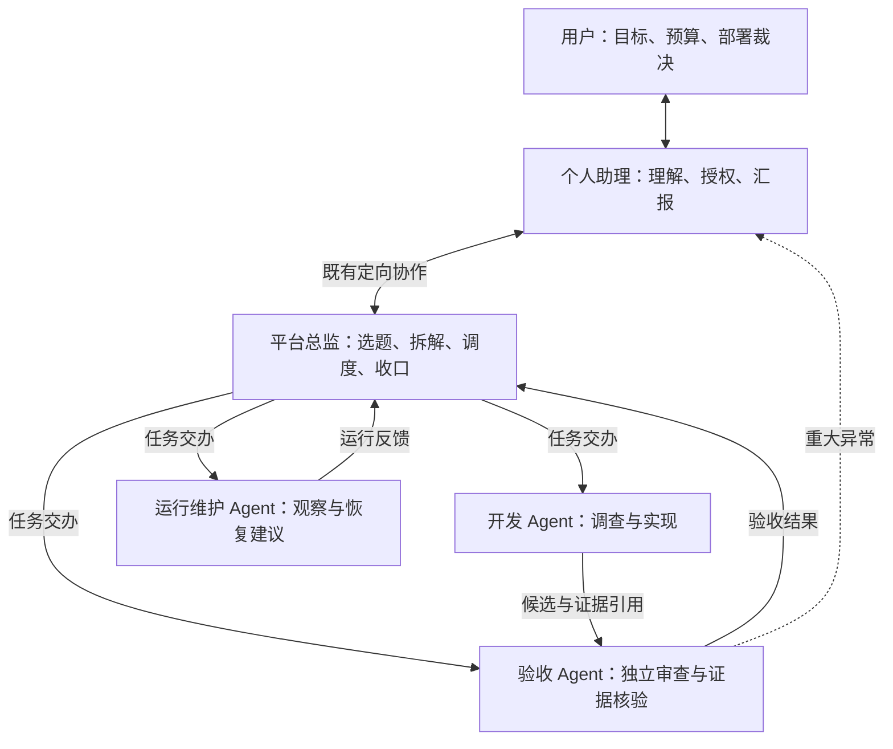

# 平台自迭代 Harness：首版方案（复用既有 Agent 通信）

- Status: 用户已确认产品方向与自主边界；本文为待实施方案，不表示功能已上线。
- Updated: 2026-10-18（Asia/Shanghai）。
- 本轮交付：角色、通信、授权、状态、恢复与实施验收约定；仅文档，不创建 Agent、不启动自主任务、不改 operator 配置。
- 关闭条件：下文 T1–T5 完成，真实 Agent 闭环与失败恢复验收有证据；届时更新状态并按 [ADR 0005](../adr/0005-docs-authority-and-archive-policy.md) 归档。
- 权威边界：用户当前授权、根 [AGENTS.md](../../AGENTS.md)、现行标准和 owning service 继续生效。本文不提前放开现有机器限制。
- 通信设计承接：遵循已确认的 [多 Agent 配置管理与协议路由研究设计](2026-08-14-multi-agent-configuration-and-protocol-routing-research-design.md)，复用本地通信实现；撤回本草案早期“先新建 A2A 通信底座、优先接入官方 SDK”的起点，不改写原设计。

## 1. 已确认的结果

用户通过个人助理表达目标，个人助理向平台总监交办；总监组织开发、独立验收与运行维护，让平台在约定目标内持续发现和处理问题。Agent 协作沿用项目既有通信设计：本地协作通过定向消息、团队/组织准入与 Agent Kernel，远端标准 A2A 互操作沿既有 Adapter / Binding 路径扩展；不强制本地交接额外经过新 HTTP 端点。首版自动完成授权范围内的开发、验证和本地合入，部署由用户决定，远端 push / PR / 发布仍需明确授权。

第一条验收链路：个人助理交办一个真实问题 → 总监形成任务约定 → 开发提交候选 → 独立验收 → 受控本地合入 → 个人助理汇报、等待部署决定 → 用户部署后观察实际效果。

首版只接入本项目预先登记的 Agent。外部任意 Agent 联邦、公开互联网发现、多项目调度、自动部署和模型权重训练不在本轮范围；后续可通过同一协议边界扩展。

## 2. 职责与通信拓扑

| 角色 | 对什么负责 | 权限约束 |
| --- | --- | --- |
| 用户 | 长期目标、资源边界、产品重大分歧、部署决定 | 随时查看证据、暂停或撤回授权 |
| 个人助理 | 维护用户意图与授权引用，集中汇报需要裁决的问题 | 不通过消息自封为用户；不代签部署与提权 |
| 平台总监 | 问题池、优先级、任务依赖、资源分配与结果收口 | 不能降低验收要求、自审自己的实现、扩大授权 |
| 开发 Agent | 在声明范围内交付可审查候选 | 隔离 worktree；没有最终验收或部署权 |
| 验收 Agent | 检查固定候选及对应证据，提出通过或返工结论 | 必须独立于该候选开发身份；不能修改被审候选 |
| 运行维护 Agent | 故障观察、归因、运行核验与恢复建议 | 本地合入与运行加载分开；重启和部署遵循现行授权 |

角色不等于持续占用一个 LLM。优先复用已有 Agent / Team 角色配置，执行会话按任务创建或复用。交办、回传与风险升级走既有通信入口，Git、测试、权限校验和 Launcher 仍由平台现有受控执行入口完成。科研组织已有 CEO、组织顾问、能力管理员等角色边界，可参考其职责模式；不能直接接管或覆盖现有科研组织和用户已配置的角色。

总监不转发所有技术消息。开发与验收可以在同一任务范围内直接交流，范围和优先级冲突归总监；重大风险可直接上报个人助理。身份与通信边由组织关系和平台授权校验，Agent 名称、persona 和 Agent Card 自述不能授予权限。

## 3. 现状与复用边界

本节是规划时的静态源码核对，不能代替正式运行实例验收。

| 现有 owner | 已有能力 | 首版需要补齐的部分 |
| --- | --- | --- |
| [定向消息工具](../../tools/agent_message_tools.py) / [Kernel 适配器](../../core/agent_kernel/adapters.py) | 明确目标 Session、同团队/组织路由、关联 ID 与投递回执 | 把投递身份、后续执行结果、候选和审查证据关联到业务任务，不另建消息工具或通信主干 |
| [Agent Kernel](../../core/agent_kernel/service.py) / [来源权威](../../core/agent_kernel/source_authority.py) | Event → Task → Execution → Outcome、投递幂等与 TaskLedger 关联 | 现有 Kernel 投递成功不是开发工作完成；编排层继续观察原生执行与交付证据 |
| [组织通信](../../core/web/services/research_organization_service.py) / [项目总线](../../core/web/services/project_agent_bus_service.py) | 通信边、消息类型/意图、唤醒策略、组织职责；总线和团队广播复用 Kernel | 复用合适的团队/组织授权范围，明确平台总监的职责与边；不复制科研组织数据或新建团队消息存储 |
| [Agent 协议模型](../../core/agent_protocol/models.py) / [解析器](../../core/agent_protocol/resolver.py) / [准入](../../core/agent_protocol/admission.py) | 已实现多协议 Binding、有效能力交集、路由指纹和逐操作准入；标准适配通用契约不激活 A2A 端点 | 仅有真实远端互操作需求时，按既有设计补 A2A adapter 与验收；不作为本地首版前置 |
| [个人助理工具](../../tools/personal_assistant_tools.py) / [service](../../core/web/services/personal_assistant_service.py) | 单例身份、受控概览与固定管理动作 | 有界的目标交办与状态查询；不增加任意 API / shell 代理 |
| [通用团队工作流](../../core/web/services/team_workflow/generic/README.md) | 顺序执行、原生 Session、持久回执、revision 与恢复 | 按任务派发与跨角色关联；不把现有顺序工作流直接宣称为并行调度 |
| [自主进化服务](../../core/web/services/self_evolution_autonomous_loop_service.py) | 观察、规划、候选实施、用户审批、集成与清理 | 目前 MAX_ITERATIONS=1，合入要求 actorType=user；新增授权策略后才能自动本地合入，不伪造用户审批 |
| [WorkRunStore](../../core/runtime_manager/work_run_store.py) | 持久运行快照与租约等现有基础 | 复用存储基础并补所需并发/恢复契约，不假设现有存储已提供全流程事务 |
| [候选集成](../../core/web/services/supervised_candidate_integration_service.py) / [task_closeout](../../scripts/task_closeout.py) | 固定候选、验证证据、expected_head、受控 ff-only 合入 | 接入独立验收和目标授权；保持唯一合入链，不在 A2A handler 中另写 Git 晋级 |

Session transcript、Turn、worker 与原生 SSE 保持既有权威。既有 [协作 Session 落点 ADR](../adr/0002-agent-collaboration-session-addressing.md) 的可靠投递、明确会话寻址与正文唯一来源约束继续适用。目标忙时延后、空闲后 drain 与启动恢复已有实现，先验证并复用；不能仅因没有远端 A2A 端点就把这些能力标成缺失，也不能把本地消息工具改名后宣称标准远端 A2A 已可用。

## 4. 既有通信承接与新增业务契约

### 4.1 通信落点与标准扩展边界

本地首版使用 `agent_message_tool(target_session=...)`；跨 Agent 先通过同团队关系或组织通信策略，再汇入 `submit_agent_message_event` 与 Kernel 投递。项目总线/团队广播用于公共指令与公告，不替代日常定向交接。优先沿现有工具、组织关系与回执模型补业务关联，不另建一套通信总线、邮箱或会话状态机。

既有协议设计采用协议中立内核、多 Binding 和权限交集，区分内部编排与跨系统互操作。后续远端 A2A 接入复用 `EffectiveAgentGraph` / `ResolvedAgentRoute`，按原设计的适配任务补充版本、能力协商与真实双端验收，不重做统一路由。第一阶段不新增生产依赖；只有互操作证据证明 SDK 能降低维护成本时，才按原设计另行评估许可证、依赖与固定版本。网络绑定和 SDK 版本不是本地首版必须先确定的产品选择。

既有设计与落地证据入口：

- [已确认的协议路由设计](2026-08-14-multi-agent-configuration-and-protocol-routing-research-design.md)：协议职责、多 Binding、来源权威与第一阶段不增加生产依赖；历史差距描述须与当前代码核对，不能当作尚未实施清单。
- [领域词汇](../agents/domain.md)：点对点协作、Project Agent Bus、Team Broadcast 和 Inbox 的职责区分。
- [定向消息回归](../../tests/test_agent_message_session_addressing.py)、[Kernel 回归](../../tests/test_agent_kernel.py)、[组织通信回归](../../tests/test_research_organization_service.py) 和 [协议图回归](../../tests/test_agent_protocol_graph.py)：实现事实优先于计划中的“拟新增”表述。

### 4.2 消息和任务约定

保留现有消息工具字段和 `historyStatus` / `wakeStatus` 等回执原义。开发、审查等可追踪工作由业务编排记录关联消息、Kernel 投递任务与后续原生执行结果。平台目标、范围、预算、授权引用等采用版本化业务负载，不能把自定义字段伪称为 A2A 标准字段；将来经远端适配时再映射为标准 Message / Task / Artifact。

业务负载初版 schema 名称拟为 `vibelution.harness.v1`，至少包含：

| 内容 | 约定 |
| --- | --- |
| 身份与关联 | 平台目标 ID、父任务引用、关联 ID、发送消息 ID；真正发送者从认证上下文取得，负载不能冒充 |
| 工作定义 | 目标、完成标准、输入证据引用、负责人角色、依赖和优先级 |
| 写入与权限 | 明确的仓库/文件范围、只读或写入类别、平台授权记录引用；不在负载内携带 secret |
| 资源 | 有限时长、调用/费用预算与重试上限；额度来自 operator 已配置档案，没有配置时显式阻止启动 |
| 输出 | 交付物类型、候选版本、验证证据与未解决问题；大型内容通过有权读取的引用传递 |

本地使用明确的 `target_session`、`thread_id` 与现有 Kernel 关联 ID；接收会话必须属于目标 Agent。业务任务与消息、投递任务、Session Turn 不是一一对应。总监把已获授权的执行会话交给发送入口，不能根据文本猜默认 direct Session，也不能跳过同团队/组织通信准入。

父运行保存业务任务和原生 ID 的引用，不把消息送达视为任务完成。远端互操作扩展时才引入协议 contextId / Task ID 的绑定范围映射，沿用既有 `RemoteIdentityRef` 等契约；远端 ID 不成为本地主键。Agent 交办和回传不得绕过现有通信入口直接创建对端执行任务；平台编排适配层按授权使用已有原生服务。

### 4.3 投递、幂等与产物

复用 Kernel 已有的事件幂等与回执关联，但不能假定每次重调消息工具都会重用同一消息身份。新增业务派发应持久绑定发送者、接收方、逻辑派发 ID、负载指纹和已有消息/任务回执；相同逻辑派发与相同负载复用原记录，相同键与不同负载拒绝。重试先对账已受理任务，不再创建第二套消息幂等存储。

断线、超时和回执未知不等于任务失败；通过已关联的 Kernel 任务、Inbox 投递记录和原生 Session 先对账。未知是否已受理时不得盲目生成新消息 ID 重跑；忙时延后与恢复优先沿既有路径处理。投递恢复与外部副作用幂等分别验证，不宣称跨进程 exactly-once。

业务交付物保存受控引用：候选绑定 base/head、变化文件与 manifest，审查绑定相同候选及证据指纹；正文继续从各自 owner 读取。远端 A2A 扩展再将其映射到 Artifact。引用访问重新校验 ACL，不泄露任意本地路径或把远端 URL 直接作为可信下载目标。Agent 不需要共享彼此的完整 Prompt、私有记忆或工具轨迹。

## 5. 状态、独立验收与授权

### 5.1 状态权威

平台父运行使用 WorkRunStore 保存业务编排快照；执行子任务继续由现有 Session / candidate service 持有原生生命周期，父记录只保存关联与派生阶段。Kernel / TaskLedger 继续持有通信事件和投递任务，不迁移到 WorkRunStore；父运行只关联其 ID。未来协议适配记录同样引用现有 owner，不能成为另一个执行引擎。恢复映射和 revision 必须原子持久化或可对账。

拟议业务阶段为 `queued → planning → developing → reviewing → integrating → awaiting_deployment → observing → completed`；这些是新编排记录的 phase，不能混进标准 TaskState 或改变普通 Session 状态枚举。失败、阻塞、停止和恢复信息单独保留原因及下一动作。

Kernel 当前把“事件成功投递”记为投递任务 succeeded，不能将其当作开发完成。业务编排分别观察原生执行与候选验收状态，不回写通信任务终态来追踪后续开发。没有权限不能误报为正在执行；认证缺失和业务授权不足分别处理。未来标准 A2A 状态映射遵循既有设计与版本化 schema，不能把本地业务 phase 塞入协议枚举。返工创建有关联的新尝试，保留旧记录。

开发执行完成只表示本次执行结束，候选是否交付必须核验；验收执行完成也可能给出返工结论。父运行必须校验结论、交付物及候选绑定后才能前进。本地合入后进入等待部署；只有用户部署授权和实际运行证据到达，才继续观察并判断目标是否达成。

### 5.2 分级授权与独立验收

用户确认的自动开发、验证、本地合入范围，通过平台保存的目标授权记录表达。它绑定项目、目标、允许操作、写域、预算、有效期与撤销状态；启动、派发、执行副作用和合入前均重新校验。总监的自然语言命令、角色名称和 A2A 负载不能替代该记录。

保留现有逐次用户审批入口；新增自动策略必须有显式 opt-in 和服务端策略裁决，不把 `actorType` 伪装成 user，不通过 yolo/full_access 绕过原门禁，也不静默把现有所有自进化任务升级成自动合入。

自动本地合入至少同时满足：范围/授权仍有效、独立验收通过、证据绑定当前候选、当前 main 可快进、质量验证通过、受控集成租约有效。验收提交者必须是被授权且独立于实现者的身份；模型输出里的“APPROVE”不能直接驱动合入。

预算增加、权限扩大、目标/验收标准的实质改变、活数据迁移或删除、远端操作与部署不能靠团队自行批准。已定位的普通本地修复不逐步打扰用户；正式 UI 的预览批准边界和既有受保护文件限制仍保持，不因总监自动选题绕过。

## 6. 低沟通调度与失败恢复

优先处理用户明确任务；严重故障与数据风险可打断普通工作，其次处理重复人工介入、可测量的效率成本和既定产品目标内的改进。事件需附来源、出现次数和影响，不以任务数、代码量或自评分当进化收益。新功能扩张先围绕用户已确认的产品方向。

总监读取持久任务队列，使用事件唤醒与有界恢复扫描；没有工作就等待，不持续空转 LLM。复用组织通信已实现的意图唤醒策略：决策/风险升级与普通报告区分处理。只联系相关接收者、不发纯确认回执、无变化不重复发送等已有上下文规则继续使用；它们部分是 Agent 行为约定，不能冒充机器强制的预算和防循环机制。常规进度聚合汇报；重大风险、预算越界、需要用户输入和部署裁决形成集中决策请求。等待部署不重复催促，也不阻止其他独立任务推进。

| 情况 | 必须行为与可观察证据 |
| --- | --- |
| 重复消息、重复回调 | 命中原消息/任务回执，不重复创建 Session、worktree 或合入 |
| 对端忙、队列拥塞 | 明确排队或拒绝原因，保持原任务身份，按有限预算等待；不打断无关 Turn |
| 服务重启、owner 失联 | 恢复扫描对账原生 Session/Turn 和 worktree；旧 worker 带租约代次隔离，不能在接管后写入 |
| 主分支前进、证据变化 | 保持既有 stale_main/候选绑定检查；证据只在内容和验证面仍适用时复用，不强推或伪造验收 |
| 审查返工、重试耗尽 | 有界新尝试并保留关联；达到时长/次数/费用上限后阻塞该任务，报告具体证据，继续独立工作 |
| 请求取消 | accepted 与实际停止分开；目标是明确的原生 Turn/任务；先观察稳定终态，再释放执行资源 |
| 合入中取消、集成后清理失败 | 集成原子段按既有语义收口；已合入事实不能回写失败；只恢复清理，不重复合入 |
| 部署请求缺少授权 | 留在 awaiting_deployment，保持现有运行实例；不重启、不发布、不自行回滚他人改动 |

总监自己的失联也由程序级租约与恢复检查处理；不能要求失联 Agent 自己报告。暂停/撤销授权从控制服务直接生效，并传播到子任务，不能只发送一条等待 Agent 阅读的聊天消息。

## 7. 实施顺序与写入 owner

T1 → T2 → T3 → T4 → T5 是首版关键路径；测试、文档与配置归入所属任务。下表模块是既有 owner，新增文件在其包内定责，不能新建平行框架。共享 Session、路由注册、公共协议模型与集成入口保持单一写入者；本计划不派发外部开发会话。

| 任务 | 可观察交付与 owning surface | 依赖与验证 |
| --- | --- | --- |
| T1：任务交接与结果关联 | 在既有 evolution / Team workflow owner 下，以 `agent_message_tool` 和 Kernel 回执关联目标、业务任务、原生 Session、候选与证据；通信 owner 保持不变 | 核对同团队/组织准入及明确目标 Session；先回归投递成功不等于执行完成、重复派发、回执未知、忙时恢复；不新建 A2A 网络底座 |
| T2：持续调度与目标授权 | 复用 WorkRunStore 与现有进化控制面，补有限队列、优先级、预算、授权记录及撤销/恢复；父运行只保存子任务引用 | 消费 T1；先做状态与权限契约回归，再实现；重启、revision 冲突、权限撤回、预算耗尽和取消终态均可验证 |
| T3：总监与独立验收交接 | 复用 Team / Agent 配置和角色绑定，通过现有定向协作组织个人助理、总监、开发与独立验收；按需扩展个人助理有界交办/查询动作 | 消费 T1/T2；固定真实身份和验收证据，不覆盖科研组织；验证通信边、意图与唤醒策略；避免修改普通 Session 内核 |
| T4：受控自动本地合入 | 在 `self_evolution_autonomous_loop_*` 与候选集成边界接入授权策略、独立审查和 manifest；继续使用现有 task_closeout/Git 晋级入口 | 消费 T2/T3；旧用户审批保持；伪造审批、自审、stale main、授权过期、未通过验证均拒绝；同候选不重复集成 |
| T5：真实闭环与运行恢复 | 在任务自己的 Launcher 实例执行一个有代表性的真实修复；记录消息、Kernel 投递任务、原生执行、候选、审查、合入与待部署状态，并演练中断恢复 | 消费 T1–T4；真实模型参与，不以 mock/HTTP 200 代替；不重启共享 main、不自动部署；观察阶段在用户部署后另取证 |

T1/T2/T4 的状态、关联和权限断言采用先失败测试再实施。可并行准备局部测试材料；依赖未闭合前不能提前部署或让正式总监自行生成写任务。初始业务并发有界，不把抬高 MAX_ITERATIONS 或无限重试当持续自治的实现。

建议复用的回归起点：`tests/test_agent_message_session_addressing.py`、`tests/test_agent_kernel.py`、`tests/test_agent_kernel_adapters.py`、`tests/test_project_agent_bus_service.py`、`tests/test_research_organization_service.py`、`tests/test_agent_protocol_graph.py`，以及 generic workflow、personal assistant、self-evolution、candidate integration 和 Session 相关测试；实际执行用变更面 selector，新增业务关联、授权和恢复测试并登记矩阵。

远端 A2A adapter 不进入首版本地关键路径。存在明确远端需求时，承接已批准协议设计中的适配任务，复用多 Binding、能力交集与本地权威映射，另做真实双端互操作验证；不把本地通信回归当作远端标准已可用的证明。

## 8. 首版验收、兼容与恢复

首版验收分层记录：本地通信与业务契约测试、跨 Agent 真实任务执行、本地审查/合入、部署授权、部署后效果。前一层通过不能代替后一层；远端 A2A 另有独立互操作验收，本轮文档完成不意味着 T1–T5 完成。

必须能复述一个任务的目标、任务身份、每个实际负责人、候选版本、验收证据、本地合入结果和为什么仍在等待部署。至少覆盖重复投递、回执未知、服务重启、权限撤回、取消竞态、返工与 stale main 的演练；同一输入不能产生重复副作用，无法确定的情况可见阻塞。

兼容策略：沿用现有定向消息、Kernel、组织/团队准入、项目总线和旧逐次审批路径，不改变普通 Session 或现有 MCP gateway。远端 A2A 仅在另行实现并启用的新 Binding 上开放。新的业务 schema 使用 v1，后续收紧/删除字段或改变幂等及状态语义须显式版本化；未知扩展字段按固定协议/schema 的规则处理，不能静默接收越权参数。

回退分开处理：关闭试点入口并停止新派发，保留已受理任务与幂等记录；对已有任务按其 owner 对账并取消或收口。关闭协议绑定不删除历史会话和交付物；运行版本回滚需另有部署授权，不能把“停止自治”自动解释成回滚产品代码。

后续实现期间如需新增可见 UI，先交付隔离预览并遵循 VUI、设计登记和前端验证要求。单纯增加后端协议/任务能力不强制先造一个新的管理工作台。

现有通信基线证据（2026-10-18）：在隔离测试环境运行 `tests/test_agent_message_session_addressing.py`、`tests/test_agent_kernel.py`、`tests/test_agent_kernel_adapters.py`、`tests/test_project_agent_bus_service.py`、`tests/test_research_organization_service.py` 和 `tests/test_agent_protocol_graph.py`，100 passed，另有一条 Starlette 弃用警告。测试时产品基线为 `6bf89daaeec5d71449092b1e78d7863282699dd5`，本方案分支仅文档有差异；这些是隔离回归证据，不是真实 Agent 自主执行或远端 A2A 运行验收。本次修订只改文档，相关源码与测试未变，复用该结果。

本轮 refresh：不需要；版本影响：纯设计文档，不 bump 产品版本；外部状态：不 push、不发布、不创建正式团队、不启用后台循环。
